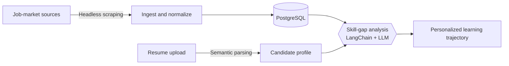
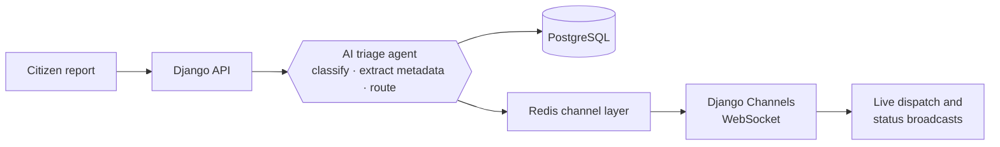
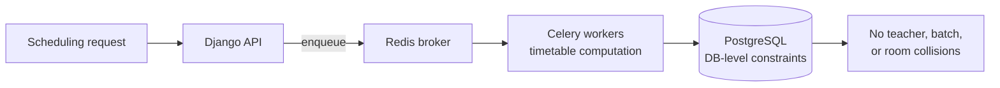
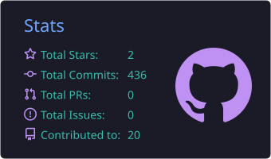
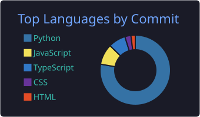
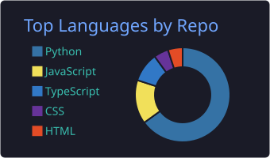
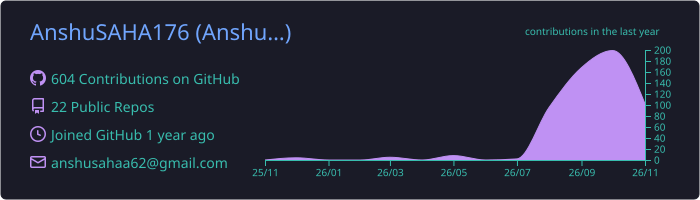
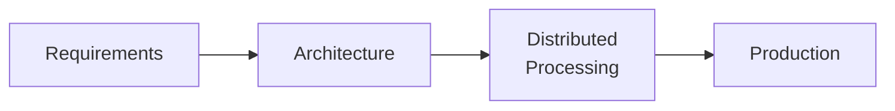

<!-- ═══════════════════════════════════════════════════════════════
     Profile README for github.com/AnshuSAHA176
     Repo must be named exactly: AnshuSAHA176/AnshuSAHA176 (public)
     ═══════════════════════════════════════════════════════════════ -->

 

  

<b>
<a href="#focus">Focus</a> &nbsp;·&nbsp;
<a href="#stack">Stack</a> &nbsp;·&nbsp;
<a href="#projects">Projects</a> &nbsp;·&nbsp;
<a href="#stats">Stats</a> &nbsp;·&nbsp;
<a href="#connect">Connect</a>
</b>

 

## 🎯 What I Do

<table>
<tr>
<td width="33%" valign="top">

### 🤖 Autonomous AI Agents
LLM-driven workflows that classify, analyze, route, and plan, wired into real backends rather than bolted on.

</td>
<td width="33%" valign="top">

### ⚡ Real-Time Systems
Persistent WebSocket connections and event-driven broadcasts for live dispatch and status updates.

</td>
<td width="33%" valign="top">

### 🧱 Resilient Backends
Constraint-first data modeling and background processing so heavy work never blocks the request path.

</td>
</tr>
</table>

 

## 🛠️ Technology Stack

  

 

## 🚀 Featured Engineering

> 💡 **Click any project to expand** its architecture diagram and core mechanisms.

<b>🤖 &nbsp;AI Career Intelligence Platform</b> &nbsp;·&nbsp; <i>job-market scraping + LLM skill-gap analysis</i>

 

> **End-to-end career intelligence engine combining automated job-market scraping, resume parsing, and LLM-driven skill-gap analysis.**

**Architecture** &nbsp;

**Core mechanisms**
- 🕸️ Headless scraping pipelines to ingest and normalize live job-market data.
- 📄 Semantic parsing of resumes to benchmark candidate profiles against market demands.
- 🧭 Agentic workflows that generate personalized learning trajectories.

<a href="https://github.com/AnshuSAHA176/AI-Career-Intelligence-Platform"><b>View repository →</b></a>

<b>🏙️ &nbsp;CivicAI — Real-Time Issue Triage</b> &nbsp;·&nbsp; <i>event-driven reporting with AI agents</i>

 

> **Event-driven civic reporting platform powered by intelligent triage workflows and bi-directional WebSocket communication.**

**Architecture** &nbsp;

**Core mechanisms**
- 📡 Real-time dispatch and status broadcasts over persistent WebSocket connections.
- 🧠 AI agents that classify incoming reports, extract metadata, and execute auto-routing.

<a href="https://github.com/AnshuSAHA176"><b>View repository →</b></a>

<b>🏫 &nbsp;Academic Scheduling Engine</b> &nbsp;·&nbsp; <i>conflict-free timetables at scale</i>

 

> **High-concurrency academic ERP backend engineered for conflict-free timetable generation and automated administrative workflows.**

**Architecture** &nbsp;

**Core mechanisms**
- 🔒 Deterministic, DB-level constraints to prevent teacher, batch, and room collisions.
- ⚙️ Asynchronous background execution via Celery to offload heavy timetable computations.

<a href="https://github.com/AnshuSAHA176"><b>View repository →</b></a>

 

## 📊 GitHub Analytics

<!-- Cards below are generated into YOUR repo by .github/workflows/stats.yml (no third-party server needed) -->

 

<b>📈 &nbsp;Profile details</b> &nbsp;<i>(click to expand)</i>

 

  

 

<!-- Needs the snake.yml GitHub Action (see .github/workflows/snake.yml) -->
<picture>
  <source media="(prefers-color-scheme: dark)" srcset="https://raw.githubusercontent.com/AnshuSAHA176/AnshuSAHA176/output/github-snake-dark.svg" />
  <source media="(prefers-color-scheme: light)" srcset="https://raw.githubusercontent.com/AnshuSAHA176/AnshuSAHA176/output/github-snake.svg" />
  
</picture>

 

## 🤝 Let's Connect

I enjoy talking about backend architecture, agent workflows, and real-time systems.

 

  

**How I ship**

<i>⚡ Build. Break. Understand. Improve.</i>

 

<a href="#readme-top">⬆ Back to top</a>

