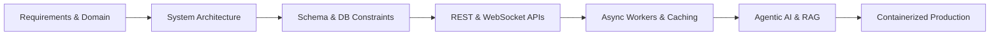
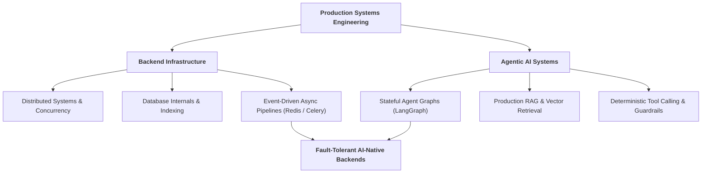

# Anshu Saha
### Backend Engineer · AI Systems Architect · Distributed Systems Builder

*Designing resilient backend architectures, autonomous AI agent workflows, and real-time data pipelines.*

 

---

## ⚡ Engineering Philosophy

I build software at the intersection of **scalable backend infrastructure** and **applied AI engineering**. My focus goes beyond writing functional endpoints—I design systems where relational databases, asynchronous task queues, WebSocket layers, and LLM orchestrators operate as a unified, fault-tolerant pipeline.

> *"I don't just write code that works. I engineer systems to understand why they work, how they fail under load, and how to make them resilient to change."*

---

## 🛠️ Technical Arsenal

| Domain | Technologies & Core Competencies |
| :--- | :--- |
| **Backend & APIs** |       |
| **Data & Infrastructure** |      |
| **AI & Agentic Systems** |      `Multi-Agent Orchestration` · `RAG Pipelines` · `Tool Calling` · `Vector Search` |
| **Automation & Pipelines** |     `Headless Scraping` · `ETL Workflows` · `Structured Data Extraction` |

---

## 🚀 Featured Systems & Architecture

### 1. [AI Career Intelligence Platform](https://github.com/AnshuSAHA176/AI-Career-Intelligence-Platform)
**End-to-end career intelligence engine combining automated job-market scraping, resume parsing, and LLM-driven skill-gap analysis.**
* **Architecture:** Built on `Django` & `DRF` with `PostgreSQL` for relational modeling and `Redis` for high-speed caching and message brokering.
* **Capabilities:**
  * **Automated Ingestion:** Scrapes and normalizes live job-market data via structured extraction pipelines.
  * **Semantic Evaluation:** Parses resumes, extracts technical taxonomies, and benchmarks candidate profiles against live market demands.
  * **Agentic Roadmaps:** Generates personalized learning trajectories and automated career recommendations.

---

### 2. [CivicAI — Real-Time Civic Issue Management](https://github.com/AnshuSAHA176)
**Event-driven civic reporting platform powered by intelligent triage workflows and bi-directional WebSocket communication.**
* **Architecture:** Combines `Django Channels` and `Redis` for low-latency state synchronization alongside autonomous AI classification agents.
* **Capabilities:**
  * **Real-Time Dispatch:** Instant status broadcasts and live notifications over persistent WebSocket connections.
  * **Intelligent Triage:** AI agents categorize incoming reports, extract location/severity metadata, and route issues to appropriate departments.
  * **Structured Lifecycle:** Full REST API surface supporting end-to-end issue tracking and resolution auditing.

---

### 3. [Campus Management & Scheduling Engine](https://github.com/AnshuSAHA176)
**High-concurrency academic ERP backend engineered for conflict-free timetable generation and automated administrative workflows.**
* **Architecture:** Enforces strict data integrity via **PostgreSQL database-level constraints**, paired with `Celery` for asynchronous task execution and `OpenAPI/Swagger` documentation.
* **Capabilities:**
  * **Zero-Conflict Scheduling:** Deterministic detection of teacher, batch, and room collisions during live scheduling and rescheduling.
  * **RBAC Security:** Granular JWT authentication partitioning student, faculty, and administrator permissions.
  * **Async Operations:** Offloads heavy timetable computations and real-time WebSocket alerts to distributed background workers.

---

## 🧩 Architectural Focus & Trajectory

My current R&D centers on bridging classic distributed systems principles with deterministic AI agent execution:

---

### 🤝 Let's Connect & Build

**16+ Public Repositories · 280+ Contributions · Actively Engineering**

  

<b>⚡ Build. Break. Understand. Improve.</b> Good software isn't just code that works—it's architecture that survives change.

